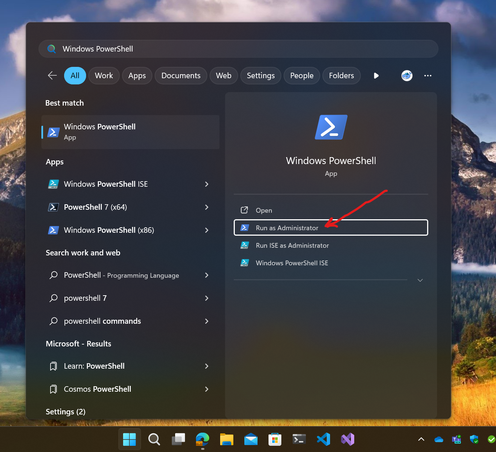
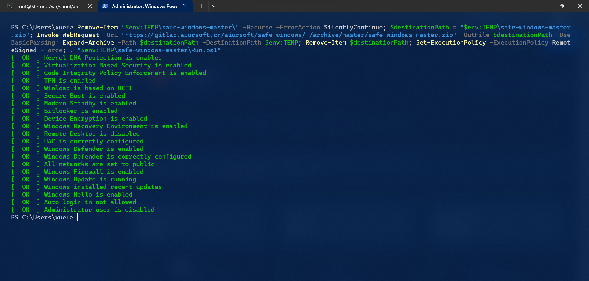

<a name="safe-windows"></a>
# Aiursoft Safe-Windows

[](https://manhours.aiursoft.com/r/github.com/aiursoftweb/Safe-Windows.html)

One-key PowerShell to check if your Windows is safe to use.

## Overview

### What is Safe-Windows?

Safe-Windows is a Windows PowerShell security-posture checker. It loads the check modules under `tools/`, checks the current machine and prints status messages and suggestions; it is not a Bash tool or a complete security guarantee.

## Installation

Use Windows with an Administrator PowerShell session and access to the GitHub source archive. The bundled checks query Windows-specific security APIs and hardware settings; a Bash environment does not provide them.

First, search `PowerShell` in Windows search. Then click `Run as administrator`.



## Usage

<a name="how-to-run"></a>
Then copy the following command and paste it into the PowerShell window. Then press `Enter`.

```powershell
Remove-Item "$env:TEMP\safe-windows-master\" -Recurse -ErrorAction SilentlyContinue; $destinationPath = "$env:TEMP\safe-windows-master.zip"; Invoke-WebRequest -Uri "https://github.com/AiursoftWeb/safe-windows/archive/master.zip" -OutFile $destinationPath -UseBasicParsing; Expand-Archive -Path $destinationPath -DestinationPath $env:TEMP; Remove-Item $destinationPath; Set-ExecutionPolicy -ExecutionPolicy RemoteSigned -Force; . "$env:TEMP\safe-windows-master\Run.ps1"
```

And then you will see the output like this:



It will show you suggestions to make your Windows safer.

<a name="is-it-safenot-safe-based-on-this-output"></a>
### Interpreting the results

This project is solely for checking if Windows complies with Microsoft's security best practices. If you do not trust Microsoft, then its theoretical security is not actual security. For example, it suggests that you use Microsoft's Secure Boot and code integrity checks. This means that your security is more easily controlled by Microsoft. Although Microsoft claims that they will focus on protecting user privacy and security, whether or not to trust Microsoft is still up to you.

If you see this project generate warnings for you, don't worry. These warnings often mean that your device may not comply with Microsoft's practices. If you can correctly assess the security risks these issues bring, for example, you are using your device in a trusted network and environment, then you can completely ignore these warnings.

Similarly, even if this project indicates that your device is very secure, you should not fully trust this project. Its output will not protect against the following:

* Being tracked by websites
* Downloading and running malicious software
* Hackers physically accessing the computer when there is no lock screen
* Inserting untrusted hardware devices

Therefore, real information security requires users to have a keen sense of problem detection and understanding of the principles, benefits, and costs of security. The warnings and information output by this project are only for quick identification by professionals.

## Configuration

There is no separate configuration file or command-line option parser. The existing one-line launcher downloads the `master` ZIP into `$env:TEMP`, removes the previous `safe-windows-master` directory, expands it, deletes the ZIP, changes the execution policy to `RemoteSigned`, then dot-sources `Run.ps1` in the current session. Review that command and the downloaded source before running it as administrator.

`Run.ps1` recursively imports `.psm1` files under the repository and checks for elevation. The available checks are implemented under [tools/](tools/); some depend on firmware, hardware or Windows security-feature availability. The printed results describe those checks, not protection against every threat.

## Development

Clone or download the repository and inspect [Run.ps1](Run.ps1) and its check modules in a Windows development environment. To run the checker from that checkout, use an elevated PowerShell session:

```powershell
. .\Run.ps1
```

The repository has no automated test suite, package build or CI configuration. Review module changes and test them on an appropriate Windows machine; Linux-only documentation checks cannot establish that Windows APIs or firmware checks work. Keep the existing example screenshots and interpretation guidance when changing output.

## How to contribute

There are many ways to contribute to the project: logging bugs, submitting pull requests, reporting issues, and creating suggestions.

Even if you have push rights on the repository, you should create a personal fork and create feature branches there when you need them. This keeps the main repository clean and your workflow cruft out of sight.

We're also interested in your feedback on the future of this project. You can submit a suggestion or feature request through the issue tracker. To make this process more effective, we're asking that these include more information to help define them more clearly.


## License

This repository does not declare a project license in a license file. Confirm reuse and redistribution terms with the maintainers.
